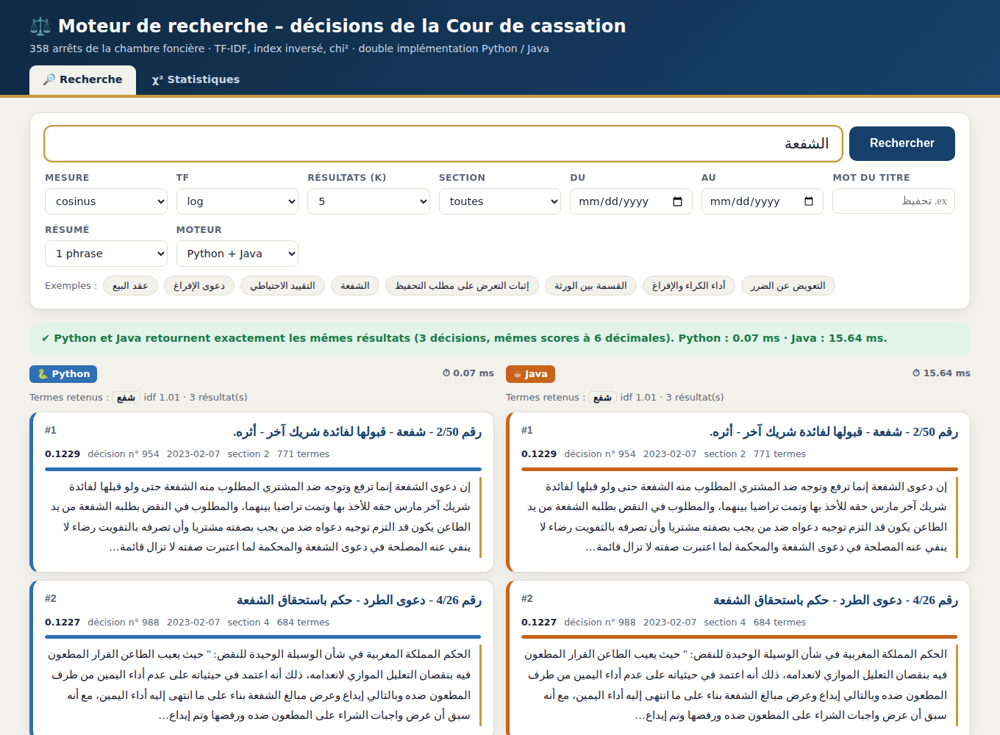
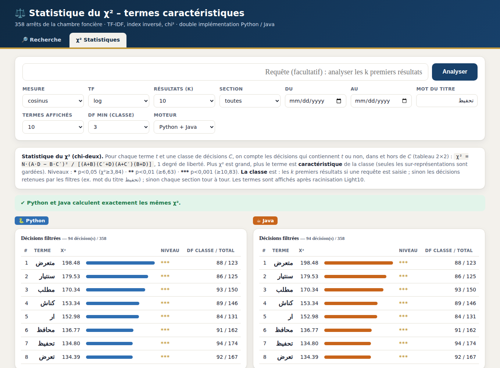

# ⚖️ Moteur de recherche pour textes juridiques arabes


  

Moteur de recherche **TF-IDF / index inversé** pour 358 décisions de la Cour de cassation marocaine (arabe), avec
statistique du **χ²**, filtres, résumé automatique et **deux implémentations équivalentes (Python et Java)** comparées
côte à côte dans un site web. Projet du module *Text Mining*.




> **English summary.** Search engine for Arabic legal decisions: Arabic preprocessing (SAFAR Light10 stemming), TF-IDF with
> an inverted index, five similarity measures, metadata filters, extractive summaries and chi-square term selection.
> The engine is implemented twice (Python, Java); a small web UI runs both and checks that their results are identical
> (33/33 strictly identical comparisons). Quick start: `cd site && python app.py`, then open http://localhost:8000.

## Démarrage rapide

```bash
git clone https://github.com/VOTRE-PSEUDO/VOTRE-DEPOT.git
cd VOTRE-DEPOT/site
python app.py            # puis http://localhost:8000  (Python 3.8+, aucune dépendance)
```
La colonne **Java** du site demande un JDK 17+ et `SAFAR_v2_jar.zip` placé à la racine (fichier non inclus dans ce dépôt) ;
sans eux, le site fonctionne avec Python seul.

---


Corpus : **358 arrêts de la Cour de cassation marocaine** (chambre foncière, 2023). L'archive
`الغرفة_العقارية.rar` contient 365 fichiers `.txt`, dont **7 vides** (770, 771, 772, 78, 783, 784, 785) :
ils sont ignorés à l'indexation et ne comptent pas dans N.

Fonctionnalités : prétraitement du texte arabe (SAFAR) · TF-IDF · **index inversé** · similarité **cosinus**
(+ produit scalaire, Jaccard, Dice, euclidienne) · **filtres de recherche** · **résumé automatique** ·
**statistique du χ² (chi-deux)** · **site web** affichant les résultats des deux moteurs côte à côte · tests et
comparaison de performances. Deux implémentations équivalentes : **Python** et **Java**.

## Principe

```
 INDEXATION (une fois)                                   RECHERCHE (à chaque requête)
 corpus/*.txt → prétraitement → index inversé            requête → même prétraitement → vecteur TF-IDF
        + métadonnées (date, section, titre)             → filtres → similarité → top-k (+ résumés)
```

**Prétraitement** (identique en Python et en Java) : suppression des diacritiques/tatwil → tokenisation (lettres
arabes) → normalisation (ى→ي ; ء آ أ ؤ إ ئ→ا) → mots vides (`ressources/stopwords_ar.txt`, 501 formes) et mots
d'une lettre supprimés → racinisation légère **Light10** de SAFAR (option `none` pour la désactiver).

**Formules**

| Élément | Définition |
|---|---|
| `idf(t)` | `log10(N / df(t))` |
| `tf(t,d)` | `raw` : c · `log` : 1 + log10(c) (défaut) · `norm` : c / \|d\| |
| poids | `tf(t,d) × idf(t)` (même formule pour la requête) |
| cosinus | `q·d / (‖q‖ ‖d‖)` |
| produit scalaire | `q·d` |
| Jaccard | `\|Q∩D\| / \|Q∪D\|` (ensembles de termes) |
| Dice | `2\|Q∩D\| / (\|Q\|+\|D\|)` |
| euclidienne | `1 / (1 + ‖q−d‖)` |

Seuls les documents partageant au moins un terme avec la requête sont retournés ; tri par score décroissant, puis par position.

## Filtres de recherche

Métadonnées extraites automatiquement des en-têtes (date : 356 décisions sur 358, de février à mai 2023 ;
section : 345 décisions sur 358) :

| Option | Effet |
|---|---|
| `--section N` | numéro X de « رقم X/Y » (1 à 4 ; déduit du numéro de décision) |
| `--du AAAA-MM-JJ` / `--au AAAA-MM-JJ` | période (bornes incluses ; les décisions sans date sont exclues) |
| `--titre MOT` | le mot doit figurer dans le titre (chapeau) de l'arrêt |

## Résumé automatique

Résumé **extractif** : le corps de la décision est découpé en phrases ; chaque phrase (≥ 5 termes) reçoit le score
`Σ poids TF-IDF des termes distincts / √(nb de termes)` ; les n meilleures sont restituées dans l'ordre du texte.
Avec une requête, ses termes comptent triple (résumé orienté requête). `--resume N` l'affiche sous chaque résultat ;
la commande `resumer ID` résume une décision.

## Statistique du χ² (chi-deux)

Mesure l'association entre un **terme** et une **classe de décisions** (module `statistiques.py` / `Statistiques.java`).
Tableau de contingence 2×2 sur la présence du terme (≥ 1 occurrence dans la décision) :

| | terme présent | terme absent |
|---|---|---|
| dans la classe C | A | C′ |
| hors de C | B | D |

`χ² = N·(A·D − B·C′)² / [(A+B)(C′+D)(A+C′)(B+D)]`, N = nombre de décisions de l'univers, 1 degré de liberté.
Niveaux : `*` χ² ≥ 3,84 (p < 0,05) · `**` ≥ 6,63 (p < 0,01) · `***` ≥ 10,83 (p < 0,001).
Seules les **sur-représentations** (A·D > B·C′) sont gardées, et le terme doit apparaître dans au moins `--min-df`
décisions de la classe (défaut 3) : le χ² n'est pas fiable sur de très petits effectifs.

Trois façons de définir la classe :

| Commande | Classe C | Univers |
|---|---|---|
| `chi2` | chaque section 1 à 4, tour à tour | décisions dont la section est connue (345) |
| `chi2 --titre تحفيظ` (ou `--section`, `--du`, `--au`) | décisions retenues par les filtres | tout le corpus |
| `chi2 "الشفعة" -k 10` | les k premiers résultats de la requête | tout le corpus |

```bash
python3 main.py chi2 -n 15                              # vocabulaire de chaque section
python3 main.py chi2 --titre تحفيظ -n 20                # termes caractéristiques des arrêts sur le تحفيظ
python3 main.py chi2 "الشفعة" -k 10 -n 15               # termes qui distinguent les résultats d'une requête
java -cp ../SAFAR_v2_jar.zip:out Main chi2 --titre تحفيظ -n 20      # même chose en Java
```

**Lecture.** Les termes sont ceux de l'index (après Light10, ex. « شفع » pour الشفعة). La requête « الشفعة » donne par
exemple `شفع`, `استشفاع`, `بشفع` : utile pour **reformuler une requête** avec le vocabulaire des meilleurs résultats.
Pour le χ² par section, les termes les plus forts sont surtout des **noms propres** (probablement les magistrats de la
formation, présents dans l'en-tête de chaque arrêt) : la section est donc surtout une marque de formation, pas un thème
juridique. Pour un vocabulaire thématique, préférez `--titre` ou une requête.

## Site web (Python et Java côte à côte)

```bash
cd site
python3 app.py            # puis http://localhost:8000      (python3 app.py 9000 pour un autre port)
```

* **Recherche** : la même requête est exécutée par le moteur **Python** et par le moteur **Java** ; les deux listes
  sont affichées séparément (temps de calcul propre à chacun) avec un bandeau vert si classement et scores sont
  identiques à 6 décimales. Le sélecteur « Moteur » permet de n'afficher que Python ou que Java.
* **χ² Statistiques** (onglet) : mêmes trois modes que la commande `chi2`, résultats Python et Java séparés,
  barres proportionnelles au χ² et niveaux de signification ; lien direct depuis chaque recherche.
* **Java** : au démarrage, le site compile `moteur_java/src` si besoin et lance un processus `Main serveur`
  (l'index n'est chargé qu'une fois). Prérequis : JDK 17+ dans le PATH et `SAFAR_v2_jar.zip` à la racine du projet
  (ou variable d'environnement `SAFAR_JAR`). Sans Java, le site fonctionne avec Python seul et la colonne Java
  explique ce qui manque.

## Arborescence

```
corpus/                 365 fichiers .txt (dont 7 vides ignorés)
ressources/stopwords_ar.txt
moteur_python/          preprocess.py light10.py indexation.py moteur.py filtres.py resume.py statistiques.py main.py
                        benchmark.py evaluer.py tests_unitaires.py
moteur_java/src/        Preprocesseur Index Moteur Filtres Resume Statistiques Serveur Benchmark Main (.java)
site/app.py             site web (recherche Python | Java côte à côte, page χ²)
resultats/              index_py.tsv index_java.tsv evaluation.md benchmark_python.txt benchmark_java.txt
                        resultats_python.txt resultats_java.txt  (12 requêtes de test, un fichier par langage)
                        chi2_sections_*.txt chi2_titre_tahfid_*.txt  (statistique χ², un fichier par langage)
outils/rar5_extract.py  extracteur RAR5 (si vous devez ré-extraire l'archive)
requetes_test.txt  verifier_equivalence.py
```

## Utilisation – Python (3.8+, aucune dépendance)

```bash
cd moteur_python
python3 main.py indexer                                   # écrit ../resultats/index_py.tsv
python3 main.py rechercher "عقد البيع" -k 10 --mesure cosinus --tf log
python3 main.py rechercher "الشفعة" --section 2 --du 2023-02-01 --au 2023-03-31 --resume 2
python3 main.py resumer 954 -n 3
python3 main.py interactif
python3 main.py fichier ../requetes_test.txt
python3 main.py benchmark                                 # index inversé vs sans index
python3 evaluer.py                                        # P@10 et MAP indicatifs
python3 main.py chi2 ["requête"] [-n 15] [--min-df 3]    # statistique χ² (voir plus haut)
python3 -m unittest tests_unitaires -v                    # tests unitaires
```
Options : `--mesure cosinus|produit|jaccard|dice|euclidienne` · `--tf raw|log|norm` ·
`--methode index|lineaire` · `--stemming light10|none` (à l'indexation).

## Utilisation – Java (JDK 17+ ; SAFAR requis)

Placez `SAFAR_v2_jar.zip` à la racine du projet (ou adaptez le chemin). Sous Windows remplacez `:` par `;`.

```bash
cd moteur_java
javac -encoding UTF-8 -cp ../SAFAR_v2_jar.zip -d out src/*.java
java -cp ../SAFAR_v2_jar.zip:out Main indexer
java -cp ../SAFAR_v2_jar.zip:out Main rechercher "الشفعة" --section 2 --resume 2
java -cp ../SAFAR_v2_jar.zip:out Main resumer 954 -n 3
java -cp ../SAFAR_v2_jar.zip:out Main fichier ../requetes_test.txt
java -cp ../SAFAR_v2_jar.zip:out Main benchmark
java -cp ../SAFAR_v2_jar.zip:out Main chi2 "الشفعة" -k 10 -n 15
```
Mêmes options qu'en Python. Si la console affiche mal l'arabe, utilisez `fichier` ou `interactif` (lecture UTF-8 forcée).
Les autres JAR cités dans le MANIFEST de SAFAR (`lib/…`) ne sont **pas** nécessaires : `Light10Stemmer` fonctionne seul.

## Tests réalisés (tous réussis)

1. **Tests unitaires** (`tests_unitaires.py`, 11 tests) : IDF, TF, poids et cosinus recalculés à la main sur un mini-corpus,
   Jaccard/Dice, équivalence index/balayage, terme inconnu, filtres section/date/titre, **χ²** (valeur calculée à la main :
   A=8, B=2, C′=2, D=8 → 7,2 ; indépendance → 0 ; niveaux ; association négative écartée).
2. **Équivalence Python ↔ Java** (`verifier_equivalence.py`) : les deux index sont identiques octet pour octet
   (termes, TF, longueurs, dates, sections, titres) ; **33/33 comparaisons** strictement identiques (12 requêtes ×
   5 mesures × 3 schémas TF, 3 filtres, méthode sans index inversé, résumé sous les résultats, 5 résumés de décisions,
   8 analyses χ² : par section, par filtres, par requête).
   Le portage Python de Light10 a aussi été comparé à SAFAR sur les **18 141 mots** du corpus : 0 différence.
3. **Évaluation de pertinence** (`resultats/evaluation.md`) – voir ci-dessous.
4. **Benchmark de l'index inversé** – voir ci-dessous.

## L'index inversé améliore les performances (12 requêtes, 358 documents)

(Valeurs moyennes mesurées ici ; elles varient d'une machine et d'une exécution à l'autre. Détail : `resultats/benchmark_*.txt`.)

| Méthode | Python | Java |
|---|---|---|
| A. Sans index (relire et re-prétraiter tout le corpus à chaque requête) | 362 ms | 1 027 ms |
| B. Balayage des vecteurs TF-IDF de tous les documents | 0,177 ms | 0,219 ms |
| **C. Index inversé** | **0,102 ms** | **0,027 ms** |
| Accélération C vs A | ×3 543 | ×38 462 |
| Accélération C vs B | ×1,7 | ×8,2 |

Les trois méthodes retournent exactement les mêmes résultats. Le gain face au balayage (B) reste modeste
sur 358 documents ; il croît avec la taille du corpus, car l'index inversé ne parcourt que les documents
contenant les termes de la requête.

## Évaluation de pertinence (indicative)

8 requêtes thématiques ; un document est « pertinent » si le **titre** de l'arrêt contient le mot-clé du thème.
Ce n'est pas un jugement humain, et le titre fait partie du texte indexé : à utiliser pour **comparer** des
configurations, pas comme score absolu.

| Configuration | P@10 | MAP |
|---|---|---|
| sans stemming, cosinus | 0,525 | 0,509 |
| **Light10 (SAFAR), cosinus** | **0,600** | **0,589** |
| Light10, produit scalaire | 0,575 | 0,592 |
| Light10, Jaccard / Dice | 0,362 | 0,366 |
| Light10, euclidienne | 0,138 | 0,196 |

À retenir : le stemming améliore le cosinus ; cosinus et produit scalaire sont les meilleures mesures ;
Jaccard/Dice ignorent les poids ; la distance euclidienne favorise les documents courts. Les schémas `raw` et `norm`
donnent le même classement en cosinus (la normalisation par |d| disparaît) et un MAP un peu plus élevé que `log`
(0,644 contre 0,589) sur ces 8 requêtes : écart à confirmer sur un jeu de requêtes plus large.

## Limites

- Le corpus contient des erreurs d'OCR (ex. « الصاور » pour « الصادر », « علف » pour « ملف »).
- Light10 est un stemmer léger (préfixes/suffixes) : il ne produit pas de vraies racines.
- La signification exacte du numéro de section (1 à 4) est déduite du numéro de décision, pas d'un document officiel.
- Le résumé est extractif : il reprend des phrases du texte, il ne reformule pas ; les phrases des arrêts étant longues,
  il est tronqué à l'affichage (260 caractères sous les résultats, 400 pour `resumer`).
- Pas d'index positionnel : pas de recherche de phrase exacte.
- χ² : calculé sur la présence/absence d'un terme dans une décision (pas sur le nombre d'occurrences) ; avec peu de
  documents dans la classe (ex. k = 5) les valeurs sont peu stables, d'où le seuil `--min-df`.
- Sous Windows, les arguments en arabe passés à Java en ligne de commande peuvent être déformés par la console ;
  utiliser `fichier`/`interactif`, ou le site web (qui communique en UTF-8 avec Java).

## Données et licence

* Code : licence MIT (voir `LICENSE`).
* Le corpus (`corpus/`) est composé de décisions de justice publiées ; il est fourni à titre pédagogique.
* La bibliothèque **SAFAR** n'est pas redistribuée ici : elle reste soumise à la licence de ses auteurs.
